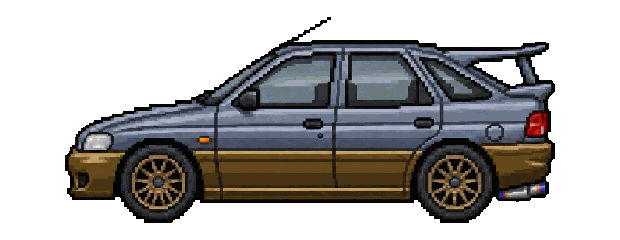
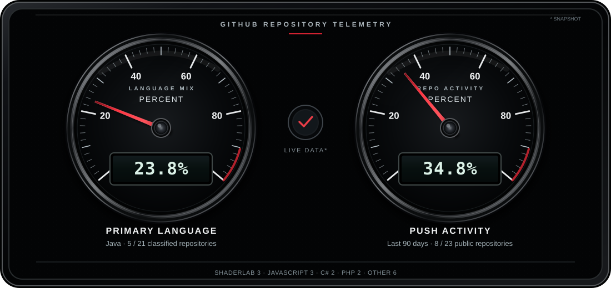

  

I hold a bachelor's degree in **Systems and Digital Media** from the **Federal University of Ceará (UFC)** in Fortaleza, Brazil. I build backend applications with Java and Spring Boot and have experience supporting ERP systems and working with SQL Server. My projects also include game development in Unity and automotive electronics with Speeduino.

## Recent projects

| Project | What it explores |
| :--- | :--- |
| **[Spring Boot Training · Vehicle and Owner Registry](https://github.com/gui123sparda/Projeto-Spring-Treinamento)** | A Spring Boot and PostgreSQL training project for managing vehicle and owner records. |
| **[Ruby on Rails CRUD](https://github.com/gui123sparda/Projeto-CRUD-Ruby-on-Rails)** | A web project for creating, reading, updating, and deleting records with Ruby on Rails. |
| **[Android CRUD](https://github.com/gui123sparda/Projeto-CRUD-Android)** | An Android CRUD project written primarily in Dart. |
| **[Speedroid](https://github.com/gui123sparda/Projeto-Speedroid)** | Java project. |

**Undergraduate thesis · Speeduino ECU**  
I implemented an open-source engine control unit on a Ford Escort Zetec 1.8 and compared its idle stability with that of the factory ECU.

  

## Languages and tools

  

| Area | Technologies |
| :--- | :--- |
| Backend &amp; databases | Java, Spring Boot, Maven, PostgreSQL, SQL Server |
| Web | JavaScript, React |
| Game development | C#, Unity, Godot |
| Embedded systems | C++, Arduino, ESP32, Speeduino |
| Version control | Git, GitHub |

## Repository snapshot

  

Public repos owned by gui123sparda, excluding forks · Nov 16, 2026. Languages count repositories by GitHub’s primary language label. Repositories without a language are included in push activity only.

## GitHub contributions

  

